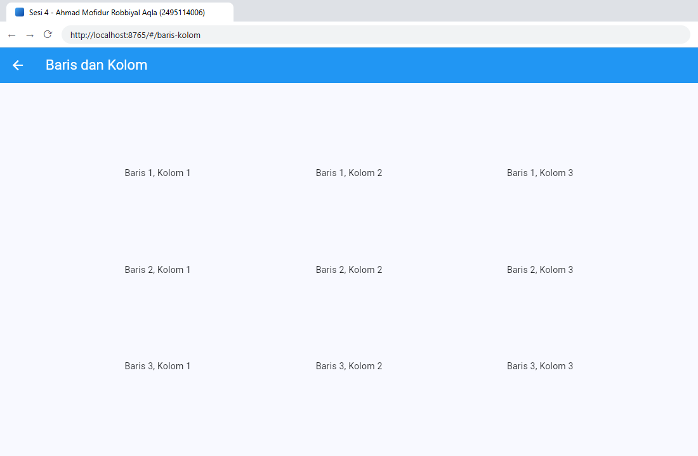
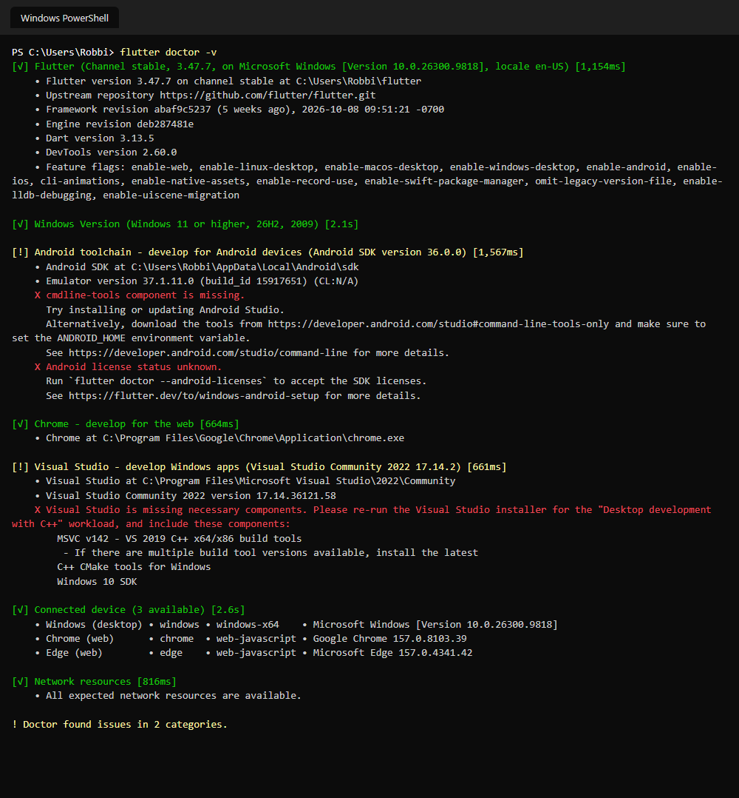
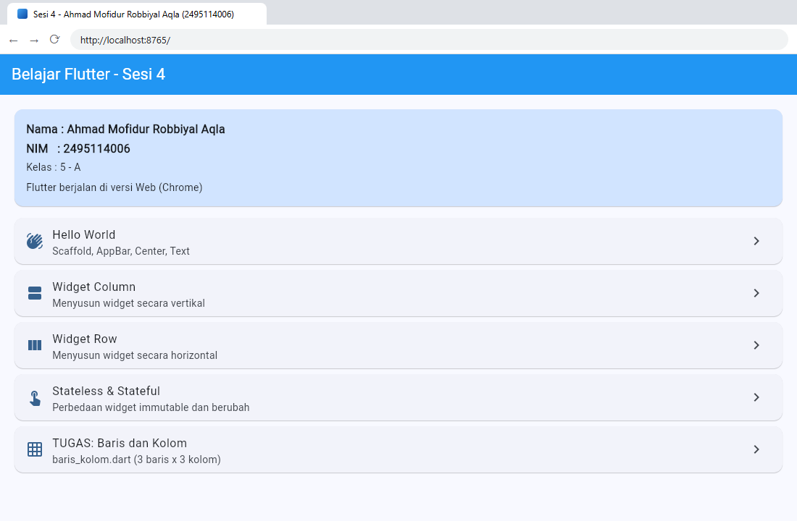

# Sesi 4 – Hasil Instalasi Flutter dan Menjalankan Versi Web

**Ahmad Mofidur Robbiyal Aqla – 2495114006**

PDF tugas (SS instalasi + hasil build Flutter, dengan nama & NIM):
[`laporan/Tugas_Sesi4_Instalasi_Flutter_Web_Ahmad_Mofidur_Robbiyal_Aqla_2495114006.pdf`](laporan/Tugas_Sesi4_Instalasi_Flutter_Web_Ahmad_Mofidur_Robbiyal_Aqla_2495114006.pdf)

## Isi

| Folder / file | Keterangan |
|---|---|
| `aplikasi_flutter_pertamaku/lib/main.dart` | MaterialApp + daftar route ke setiap latihan |
| `aplikasi_flutter_pertamaku/lib/menu_praktikum.dart` | halaman awal: nama, NIM, dan menu latihan |
| `aplikasi_flutter_pertamaku/lib/hello_world.dart` | praktikum Hello World (Scaffold, AppBar, Center, Text) |
| `aplikasi_flutter_pertamaku/lib/column_widget.dart` | praktikum widget Column |
| `aplikasi_flutter_pertamaku/lib/row_widget.dart` | praktikum widget Row |
| `aplikasi_flutter_pertamaku/lib/stateless_stateful.dart` | contoh StatelessWidget dan StatefulWidget |
| `aplikasi_flutter_pertamaku/lib/baris_kolom.dart` | **TUGAS**: tampilan 3 baris x 3 kolom |
| `hasil_build_web/` | hasil `flutter build web --release` |
| `screenshots/` | SS `flutter --version`, `flutter doctor -v`, `flutter devices`, build web, dan aplikasi di browser |

## Tugas `baris_kolom.dart`

Column berisi tiga Row; keduanya memakai `MainAxisAlignment.spaceEvenly`.



## Hasil instalasi



## Build dan menjalankan versi web

```bash
cd aplikasi_flutter_pertamaku
flutter run -d chrome          # mode pengembangan
flutter build web --release    # hasil di build/web
```

Menjalankan hasil build yang sudah ada di repo:

```bash
cd hasil_build_web
python -m http.server 8765     # lalu buka http://localhost:8765
```


