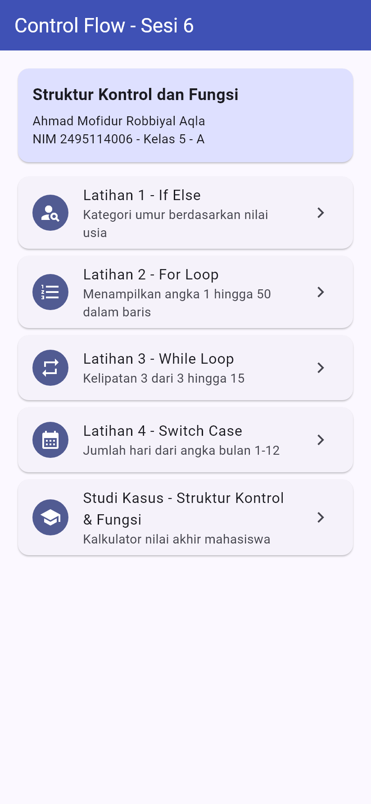
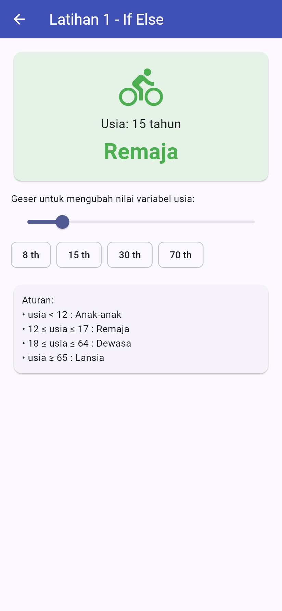
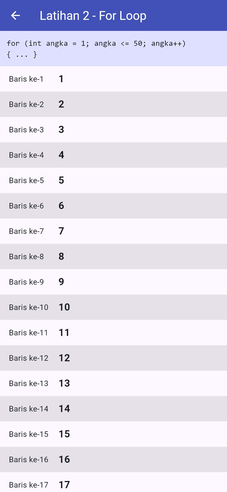
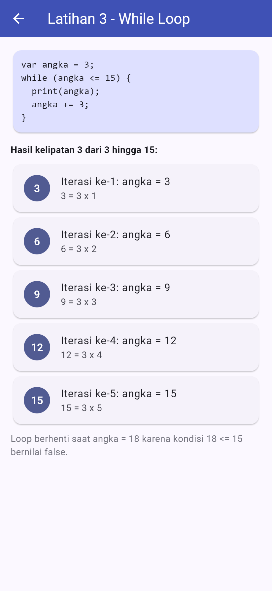
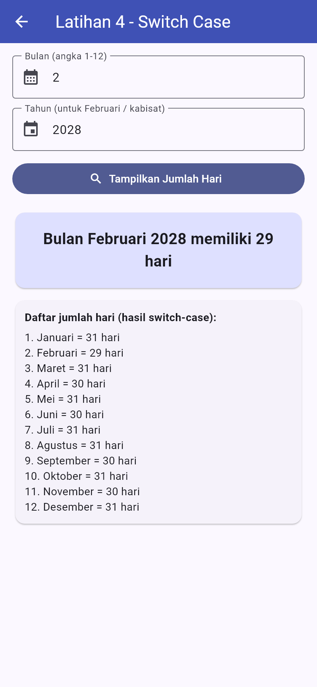
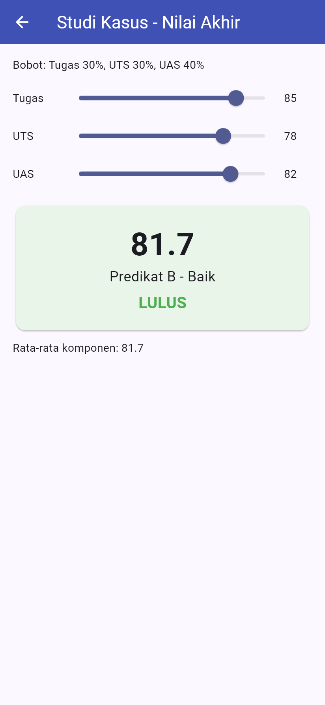

# Sesi 6 – Struktur Kontrol dan Fungsi

**Ahmad Mofidur Robbiyal Aqla – 2495114006**

## 1. Hasil praktikum – `hasil_praktikum/control_flow`

Project Dart console berisi semua contoh pada modul Bab 5 Control Flow ditambah materi fungsi.
Kode ada di `lib/control_flow.dart`, dijalankan dari `bin/control_flow.dart` (hasil di `output.txt`).

| Materi | Fungsi |
|---|---|
| If, if-else, else-if (versi awal & perbaikan dengan `&&`) | `contohIf`, `contohIfElse`, `contohElseIfAwal`, `predikatNilai` |
| Conditional expression (ternary) | `cekKelulusan` |
| Nested if | `cekKedewasaan` |
| For, for-in, forEach | `contohFor`, `contohForTeks`, `contohForIn`, `contohForEach` |
| While dan do-while | `contohWhile`, `contohDoWhile` |
| Break dan continue | `contohBreakContinue` |
| Switch-case | `contohSwitch`, `contohSwitchOperator` |
| Fungsi: return type, parameter, arrow `=>`, positional vs named, callback | `luasPersegiPanjang`, `kuadrat`, `isGenap`, `biodataPositional`, `biodataNamed`, `saring` |
| Studi kasus gabungan | `rekapNilai`, `keteranganPredikat`, `studiKasusNilai` |

```bash
cd hasil_praktikum/control_flow
dart run
dart test
```

## 2. Tugas latihan – `tugas_latihan/latihan_control_flow`

Aplikasi Flutter yang mengerjakan semua latihan di modul. Logika ada di
`lib/logika/logika.dart`, tampilan di `lib/pages/`.

| Latihan | Struktur kontrol | Halaman |
|---|---|---|
| 1. Kategori umur: Anak-anak (< 12), Remaja (12–17), Dewasa (18–64), Lansia (≥ 65) | if-else | `kategori_umur_page.dart` |
| 2. Angka 1 hingga 50 dalam bentuk baris | for | `angka_for_page.dart` |
| 3. Kelipatan 3 dari 3 hingga 15 | while | `kelipatan_while_page.dart` |
| 4. Input angka bulan 1–12 → jumlah hari (Februari mengikuti tahun kabisat) | switch-case | `jumlah_hari_page.dart` |
| Studi kasus: nilai akhir mahasiswa (bobot tugas/UTS/UAS, predikat, lulus) | gabungan if-else, switch, ternary, for-in, named parameter, arrow function | `studi_kasus_page.dart` |

```bash
cd tugas_latihan/latihan_control_flow
flutter pub get
flutter run -d chrome
flutter test
```

### Tampilan

| Beranda | Latihan 1 (if-else) | Latihan 2 (for) |
|---|---|---|
|  |  |  |

| Latihan 3 (while) | Latihan 4 (switch) | Studi kasus |
|---|---|---|
|  |  |  |
